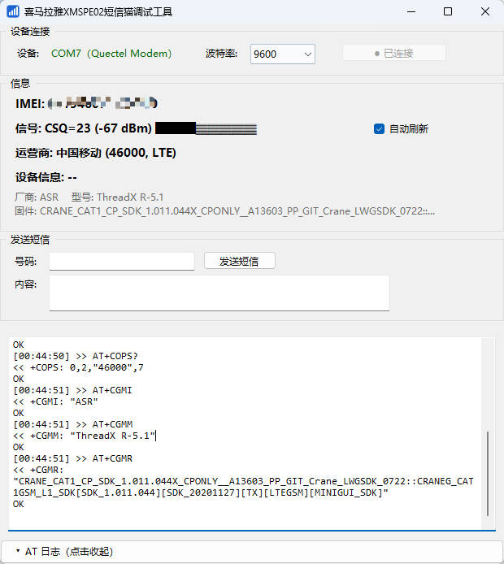

# 喜马拉雅 XMSPE02 短信调试工具

一个用于 **喜马拉雅陪伴机 mini（移动专享定制版，型号 XMSPE02 / 硬件 X5_V1.0）** 的 Windows 桌面调试工具。

该设备是插 4G 卡的老人收音机形态终端，底层为 ASR（翱捷科技）芯片方案（`VID_2ECC&PID_3010`，ThreadX RTOS），通过 USB 枚举出 AT 指令串口。本工具通过该串口查看设备状态和收发短信。




## 功能

- **自动检测连接**：每 1.5 秒自动检测设备插入，自动连接 / 断线重连，无需手动选端口
- **信息自动读取**：连接成功后自动读取 IMEI、运营商（含网络制式）、信号强度、设备信息（厂商/型号/固件）
- **信号自动刷新**：默认勾选，每 3 秒轮询信号强度（CSQ，带信号条可视化）
- **发送短信**：PDU 模式 + UCS2 编码，支持中文、英文；超过 70 汉字自动按 UDH 协议分条，对方手机自动合并
- **防休眠保活**：连接后发送 `AT+QSCLK=0` 关闭模组休眠，并每 25 秒静默发送空 AT 心跳
- **AT 日志**：可折叠日志区，自动过滤 `+EEMLTE*` 等 URC 噪音，便于排查问题

## 运行环境

- Windows 10/11
- [.NET 8 Desktop Runtime](https://dotnet.microsoft.com/download/dotnet/8.0)（仅运行发布版 exe 需要）

## 驱动安装

设备需要安装 ASR 平台串口驱动后才会出现 COM 口：

1. 下载 [Quectel ASR 平台 USB 驱动 V1.1.13](https://developer.quectel.com/wp-content/uploads/2024/09/Quectel_Windows_USB_DriverA_Customer_V1.1.13.zip) 并安装
2. 重新插拔设备，设备管理器中出现 `Quectel Modem Device (COMx)` 即成功
3. 若仍无 COM 口：设备管理器 → 带黄色感叹号的 `Mobile AT Interface` → 右键「更新驱动程序」

## 从源码编译

```bash
dotnet build -c Release
# 产物: bin/Release/net8.0-windows/xmspe02_at_tool.exe
```

需要安装 [.NET 8 SDK](https://dotnet.microsoft.com/download/dotnet/8.0)。

## Python 版

`xmspe02_at_tool.py` 为早期 tkinter + pyserial 实现的单文件版本，功能一致（无短信发送），依赖：

```bash
pip install pyserial
python xmspe02_at_tool.py
```

## 常用 AT 指令参考（该设备实测）

| 指令 | 作用 | 说明 |
|---|---|---|
| `AT+CGSN` | 读 IMEI | 返回值带引号 |
| `AT+CSQ` | 信号强度 | 值 = 99 表示未知；dBm ≈ -113 + CSQ×2 |
| `AT+CPIN?` | SIM 卡状态 | `+CME ERROR: 10` 表示未插卡 |
| `AT+COPS?` | 运营商 | 46000=中国移动；需先插卡注册网络 |
| `AT+CPSI?` | 网络信息 | ASR 平台扩展指令 |
| `AT+CMGF=0` | PDU 短信模式 | 文本模式发中文会乱码，务必用 PDU |
| `AT+QSCLK=0` | 禁止休眠 | 防止模组进入低功耗 |

## 免责声明

本工具仅供个人学习与设备调试使用，短信发送走 SIM 卡资费，请遵守当地法律法规，勿用于任何违法用途。
